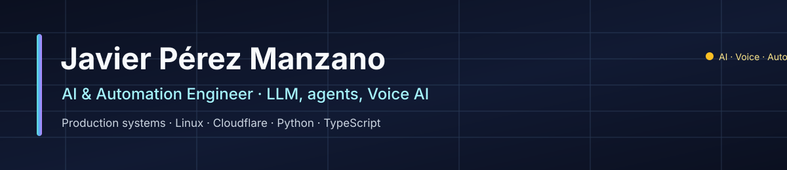

  

### Hola, soy Javier 👋

Construyo productos de IA y sistemas de automatización que funcionan en producción: agentes LLM, pipelines de voz, automatización editorial y la infraestructura que hay detrás.

Me importan las partes menos vistosas: planes deterministas, tests, revisión humana, observabilidad, higiene de secretos y que lo que entrego lo pueda usar alguien que no es ingeniero.

[English](README.md) · [Português](README.pt.md) · [日本語](README.ja.md)

---

## Experiencia

**Cofundador y Tech Lead — [Taishoku Reset](https://taishokureset.com)**  
SaaS japonés de 退職代行 con entrada por LINE, formularios web seguros, voz/traducción con IA y un stack de producción Cloudflare/Next.js. Llevo la dirección técnica y la entrega del producto.  
→ [Caso de estudio](https://github.com/javperman/portfolio/tree/main/case-studies/taishoku-reset) · recorrido de código bajo NDA

**Consultor — Minsait (Indra)** · Madrid / Remoto · mar. 2023 – actualidad  
Ingeniería de datos y automatización para la gestión de activos empresariales: ETL con Python (pandas, numpy, oracledb, openpyxl), PL/SQL y SQL sobre Oracle, dashboards en Power BI e IBM Maximo / IBM MAS. Trato directo con el cliente para requisitos e incidencias críticas, y mentoring de perfiles junior. Empecé como Data Analyst (mar. 2023 – ene. 2025). No publico código, datos ni detalles de proyectos de clientes.

**Fundador — [Peresotech](https://peresotech.com)**  
Estudio independiente de IA y automatización: productos web, integraciones de voz/LLM e investigación aplicada.

---

## Trabajo seleccionado

| Proyecto | Qué es | Evidencia |
|---|---|---|
| **[Taishoku Reset](https://taishokureset.com)** | SaaS japonés de 退職代行 en producción: LINE, formularios seguros, voz/traducción con IA y flujo operativo. | [Caso de estudio](https://github.com/javperman/portfolio/tree/main/case-studies/taishoku-reset) |
| **[Intérprete JA ⇄ ES](https://github.com/javperman/interprete-ja-es)** | Intérprete bidireccional japonés ⇄ español para Meet/Teams en Linux: PipeWire, faster-whisper, Gemini/Vertex, VOICEVOX, Piper, GTK4. 185 tests. | [Código](https://github.com/javperman/interprete-ja-es) |
| **[video-editor-ai](https://github.com/javperman/video-editor-ai)** | Pipeline determinista de edición para tutoriales técnicos: `edit_plan.json`, revisiones inmutables, ASR local, subtítulos, PiP, render NVENC y QC. 30 min → ~7,6 min, 2,5 GB pico. | [Código](https://github.com/javperman/video-editor-ai) · [Demo](https://youtu.be/XcZ60adpBms) |
| **[FitPrimeLab](https://fitprimelab.com)** | Plataforma de fitness multilingüe con herramientas interactivas y contenido editorial en EN/ES/PT/JA. | [Web](https://fitprimelab.com) · [Código](https://github.com/javperman/fitprimelab-site) |
| **[AI Engineering Playbook](https://github.com/javperman/ai-engineering-playbook)** | Cómo construyo con agentes: contratos AGENTS.md, planes por fases, checklists, tests, MCP e higiene de secretos. | [Código](https://github.com/javperman/ai-engineering-playbook) |

---

## Stack

LLM/agentes · Cloudflare Workers/D1/KV · Gemini/Vertex AI · faster-whisper · VOICEVOX · Piper · FFmpeg/NVENC · PipeWire · Linux

---

## Cómo construyo con IA

- **AGENTS.md como contrato** — invariantes, reglas de honestidad y requisitos de verificación para los agentes.
- **Planes con gates** — trabajo por fases, criterios de parada y decisiones escritas antes del código.
- **Tests como red** — arrancar la app no es aprobar; lo que depende de hardware se marca.
- **Revisión humana del diff** — el agente propone, la persona acepta; cada revisión es inspeccionable.
- **Changelog y ADRs** — las decisiones y mediciones quedan en el repositorio, no en el chat.
- **Higiene de secretos** — escaneo de archivos rastreados, sin `.env`, historia nueva y check antes del push.

Herramientas: **OpenCode**, **Claude Code**, **Gemini API** y el stack habitual de Linux/Python/TypeScript.

---

## Idiomas

- **Español** — nativo
- **Inglés** — professional working proficiency
- **Portugués** — professional working proficiency

---

## Contacto

- LinkedIn: [javier-perez-manzano](https://www.linkedin.com/in/javier-perez-manzano)
- Email: [contact@peresotech.com](mailto:contact@peresotech.com)
- Productos: [Taishoku Reset](https://taishokureset.com) · [FitPrimeLab](https://fitprimelab.com)

No publico código de clientes, datos de clientes, credenciales ni métricas internas. Los casos de estudio describen arquitectura y entrega en el nivel autorizado.
