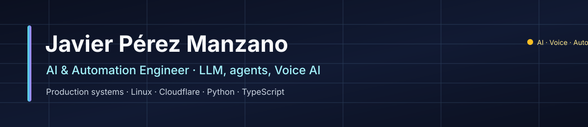

  

### こんにちは、ハビエルです 👋

本番環境で動く AI プロダクトと自動化システムを作っています。LLM エージェント、音声パイプライン、編集の自動化、その基盤まで担当します。

見た目よりも、地味な部分を大切にしています。決定的なプラン、テスト、人によるレビュー、可観測性、秘密情報の管理、そして非エンジニアでも使える形で届けることです。

[English](README.md) · [Español](README.es.md) · [Português](README.pt.md)

---

## 経歴

**共同創業者 / Tech Lead — [Taishoku Reset](https://taishokureset.com)**  
日本の退職代行 SaaS。LINE からの受付、安全な Web フォーム、AI 音声・翻訳、Cloudflare / Next.js の本番スタックを担当しています。技術方針とプロダクトの提供を担当。  
→ [ケーススタディ](https://github.com/javperman/portfolio/tree/main/case-studies/taishoku-reset) · コードの概要説明は NDA の範囲で可能です

**コンサルタント — Minsait (Indra)** · マドリード / リモート · 2023年3月 – 現在  
企業向け資産管理のデータエンジニアリングと自動化。Python による ETL（pandas、numpy、oracledb、openpyxl）、PL/SQL と Oracle SQL、Power BI ダッシュボード、IBM Maximo / IBM MAS を担当。顧客と直接やり取りして要件定義や重大インシデント対応を行い、ジュニアのメンタリングも担当。Data Analyst（2023年3月 – 2025年1月）として開始。クライアントのコード、データ、プロジェクト詳細は公開しません。

**創業者 — [Peresotech](https://peresotech.com)**  
AI と自動化の独立スタジオ。Web プロダクト、音声・LLM 連携、応用研究。

---

## 主なプロジェクト

| プロジェクト | 内容 | リンク |
|---|---|---|
| **[Taishoku Reset](https://taishokureset.com)** | 本番稼働中の日本の退職代行 SaaS。LINE、安全なフォーム、AI 音声・翻訳、運用フロー。 | [ケーススタディ](https://github.com/javperman/portfolio/tree/main/case-studies/taishoku-reset) |
| **[JA ⇄ ES Live Interpreter](https://github.com/javperman/interprete-ja-es)** | Linux の Meet/Teams 向け日西双方向通訳。PipeWire、faster-whisper、Gemini/Vertex、VOICEVOX、Piper、GTK4。185 テスト。 | [コード](https://github.com/javperman/interprete-ja-es) |
| **[video-editor-ai](https://github.com/javperman/video-editor-ai)** | 技術チュートリアル向けの決定的な編集パイプライン。`edit_plan.json`、不変リビジョン、ローカル ASR、字幕、PiP、NVENC レンダー、QC。30 分 → 約 7.6 分、ピーク 2.5 GB。 | [コード](https://github.com/javperman/video-editor-ai) · [デモ](https://youtu.be/XcZ60adpBms) |
| **[FitPrimeLab](https://fitprimelab.com)** | EN/ES/PT/JA の多言語フィットネスプラットフォーム。インタラクティブなツールと記事。 | [サイト](https://fitprimelab.com) · [コード](https://github.com/javperman/fitprimelab-site) |
| **[AI Engineering Playbook](https://github.com/javperman/ai-engineering-playbook)** | エージェントとの開発方法。AGENTS.md の契約、フェーズ計画、レビュー、テスト、MCP、秘密情報の管理。 | [コード](https://github.com/javperman/ai-engineering-playbook) |

---

## スタック

LLM / エージェント · Cloudflare Workers/D1/KV · Gemini/Vertex AI · faster-whisper · VOICEVOX · Piper · FFmpeg/NVENC · PipeWire · Linux

---

## AI を使った開発

- **AGENTS.md を契約にする** — 不変条件、正直さのルール、検証要件をエージェントに明示します。
- **ゲート付きのフェーズ計画** — 停止条件と決定をコードより先に書きます。
- **テストを安全網にする** — アプリが起動しただけでは合格にしません。ハードウェア依存の確認は明記します。
- **diff の人によるレビュー** — エージェントが提案し、人が受け入れます。すべてのリビジョンは検査可能です。
- **Changelog と ADR** — 決定と測定値をチャットではなくリポジトリに残します。
- **秘密情報の管理** — 追跡ファイルのスキャン、`.env` を置かない、履歴を新しくする、push 前のチェック。

使用ツール: **OpenCode**、**Claude Code**、**Gemini API**、Linux / Python / TypeScript。

---

## 言語

- **スペイン語** — ネイティブ
- **英語** — professional working proficiency
- **ポルトガル語** — professional working proficiency

---

## 連絡先

- LinkedIn: [javier-perez-manzano](https://www.linkedin.com/in/javier-perez-manzano)
- Email: [contact@peresotech.com](mailto:contact@peresotech.com)
- プロダクト: [Taishoku Reset](https://taishokureset.com) · [FitPrimeLab](https://fitprimelab.com)

クライアントのコード、顧客データ、認証情報、内部指標は公開しません。ケーススタディは、許可された範囲でアーキテクチャと提供内容を説明します。
