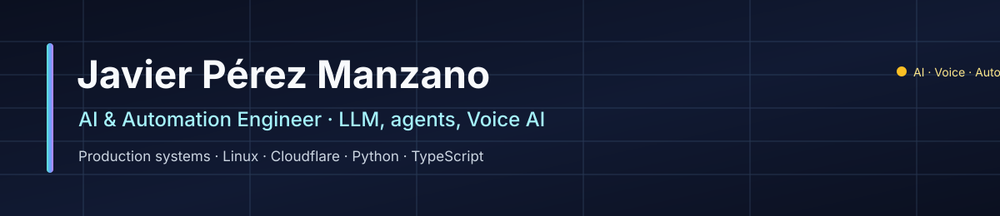

  

### Hi, I'm Javier 👋

I build AI products and automation systems that run in production: LLM agents, voice pipelines, editorial automation, and the infrastructure behind them.

I care about the unglamorous parts: deterministic plans, tests, human review, observability, secret hygiene, and shipping something a non-engineer can actually use.

[Español](README.es.md) · [Português](README.pt.md) · [日本語](README.ja.md)

---

## Experience

**Co-Founder & Tech Lead — [Taishoku Reset](https://taishokureset.com)**  
Japanese exit-agency SaaS (退職代行) with LINE intake, secure web forms, AI voice/translation, and a Cloudflare/Next.js production stack. I own the technical direction and the delivery of the product.  
→ [Case study](https://github.com/javperman/portfolio/tree/main/case-studies/taishoku-reset) · code walkthrough under NDA

**Consultant — Minsait (Indra)** · Madrid / Remote · Mar 2023 – Present  
Data engineering and automation for enterprise asset management: Python ETL (pandas, numpy, oracledb, openpyxl), PL/SQL and Oracle SQL, Power BI dashboards, and IBM Maximo / IBM MAS. I work directly with the client on requirements and critical incidents, and mentor junior profiles. Started as Data Analyst (Mar 2023 – Jan 2025). No client code, data or project specifics are published.

**Founder — [Peresotech](https://peresotech.com)**  
Independent AI and automation studio: web products, voice/LLM integrations, and applied research.

---

## Selected work

| Project | What it is | Evidence |
|---|---|---|
| **[Taishoku Reset](https://taishokureset.com)** | Japanese exit-agency SaaS in production: LINE intake, secure forms, AI voice/translation, operations workflow. | [Case study](https://github.com/javperman/portfolio/tree/main/case-studies/taishoku-reset) |
| **[JA ⇄ ES Live Interpreter](https://github.com/javperman/interprete-ja-es)** | Bidirectional Japanese ⇄ Spanish interpreter for Meet/Teams on Linux: PipeWire, faster-whisper, Gemini/Vertex, VOICEVOX, Piper, GTK4. 185 tests. | [Code](https://github.com/javperman/interprete-ja-es) |
| **[video-editor-ai](https://github.com/javperman/video-editor-ai)** | Deterministic editing pipeline for technical tutorials: `edit_plan.json`, immutable revisions, local ASR, subtitles, PiP, NVENC render, QC. 30 min → ~7.6 min, 2.5 GB peak. | [Code](https://github.com/javperman/video-editor-ai) · [Demo](https://youtu.be/XcZ60adpBms) |
| **[FitPrimeLab](https://fitprimelab.com)** | Multilingual fitness platform with interactive tools and editorial content in EN/ES/PT/JA. | [Live](https://fitprimelab.com) · [Code](https://github.com/javperman/fitprimelab-site) |
| **[AI Engineering Playbook](https://github.com/javperman/ai-engineering-playbook)** | How I build with agents: AGENTS.md contracts, phased plans, review checklists, testing, MCP and secret hygiene. | [Code](https://github.com/javperman/ai-engineering-playbook) |

---

## Stack

LLM/agents · Cloudflare Workers/D1/KV · Gemini/Vertex AI · faster-whisper · VOICEVOX · Piper · FFmpeg/NVENC · PipeWire · Linux

---

## How I build with AI

- **AGENTS.md as a contract** — invariants, honesty rules, and verification requirements for coding agents.
- **Plans with gates** — phased work, explicit stop conditions, and decisions written down before code.
- **Tests as a safety net** — a test that only starts the app is not a pass; hardware-dependent checks are marked.
- **Human review of the diff** — the agent proposes, the human accepts; every revision is inspectable.
- **Changelog and ADRs** — decisions and measurements stay in the repository, not in chat history.
- **Secret hygiene** — tracked-file scans, no `.env`, fresh Git history, and a pre-push check.

Tools I use: **OpenCode**, **Claude Code**, **Gemini API**, and the usual Linux/Python/TypeScript stack.

---

## Languages

- **Spanish** — native
- **English** — professional working proficiency
- **Portuguese** — professional working proficiency

---

## Contact

- LinkedIn: [javier-perez-manzano](https://www.linkedin.com/in/javier-perez-manzano)
- Email: [contact@peresotech.com](mailto:contact@peresotech.com)
- Live products: [Taishoku Reset](https://taishokureset.com) · [FitPrimeLab](https://fitprimelab.com)

I do not publish client code, customer data, credentials, or internal metrics. Case studies describe architecture and delivery at the level the client authorized.
