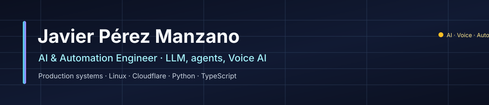

  

### Olá, sou Javier 👋

Construo produtos de IA e sistemas de automação que funcionam em produção: agentes LLM, pipelines de voz, automação editorial e a infraestrutura por trás disso.

Gosto das partes menos glamourosas: planos determinísticos, testes, revisão humana, observabilidade, higiene de segredos e entregar algo que uma pessoa não engenheira consiga usar.

[English](README.md) · [Español](README.es.md) · [日本語](README.ja.md)

---

## Experiência

**Cofundador e Tech Lead — [Taishoku Reset](https://taishokureset.com)**  
SaaS japonês de 退職代行 com entrada por LINE, formulários web seguros, voz/tradução com IA e stack de produção Cloudflare/Next.js. Responsável pela direção técnica e pela entrega do produto.  
→ [Estudo de caso](https://github.com/javperman/portfolio/tree/main/case-studies/taishoku-reset) · walkthrough de código sob NDA

**Consultor — Minsait (Indra)** · Madri / Remoto · mar. 2023 – atual  
Engenharia de dados e automação para gestão de ativos empresariais: ETL com Python (pandas, numpy, oracledb, openpyxl), PL/SQL e SQL em Oracle, dashboards em Power BI e IBM Maximo / IBM MAS. Contato direto com o cliente para requisitos e incidentes críticos, além de mentoring de perfis júnior. Comecei como Data Analyst (mar. 2023 – jan. 2025). Não publico código, dados nem detalhes de projetos de clientes.

**Fundador — [Peresotech](https://peresotech.com)**  
Estúdio independente de IA e automação: produtos web, integrações de voz/LLM e pesquisa aplicada.

---

## Trabalho selecionado

| Projeto | O que é | Evidência |
|---|---|---|
| **[Taishoku Reset](https://taishokureset.com)** | SaaS japonês de 退職代行 em produção: LINE, formulários seguros, voz/tradução com IA e fluxo operacional. | [Estudo de caso](https://github.com/javperman/portfolio/tree/main/case-studies/taishoku-reset) |
| **[Intérprete JA ⇄ ES](https://github.com/javperman/interprete-ja-es)** | Intérprete bidirecional japonês ⇄ espanhol para Meet/Teams no Linux: PipeWire, faster-whisper, Gemini/Vertex, VOICEVOX, Piper, GTK4. 185 testes. | [Código](https://github.com/javperman/interprete-ja-es) |
| **[video-editor-ai](https://github.com/javperman/video-editor-ai)** | Pipeline determinístico de edição para tutoriais técnicos: `edit_plan.json`, revisões imutáveis, ASR local, legendas, PiP, render NVENC e QC. 30 min → ~7,6 min, 2,5 GB de pico. | [Código](https://github.com/javperman/video-editor-ai) |
| **[FitPrimeLab](https://fitprimelab.com)** | Plataforma de fitness multilíngue com ferramentas interativas e conteúdo editorial em EN/ES/PT/JA. | [Site](https://fitprimelab.com) · [Código](https://github.com/javperman/fitprimelab-site) |
| **[AI Engineering Playbook](https://github.com/javperman/ai-engineering-playbook)** | Como construo com agentes: contratos AGENTS.md, planos por fases, checklists, testes, MCP e higiene de segredos. | [Código](https://github.com/javperman/ai-engineering-playbook) |

---

## Stack

LLM/agentes · Cloudflare Workers/D1/KV · Gemini/Vertex AI · faster-whisper · VOICEVOX · Piper · FFmpeg/NVENC · PipeWire · Linux

---

## Como construo com IA

- **AGENTS.md como contrato** — invariantes, regras de honestidade e requisitos de verificação para agentes.
- **Planos com gates** — trabalho por fases, critérios de parada e decisões registradas antes do código.
- **Testes como rede** — abrir o app não é passar; o que depende de hardware é marcado.
- **Revisão humana do diff** — o agente propõe, a pessoa aceita; cada revisão é inspecionável.
- **Changelog e ADRs** — decisões e medições ficam no repositório, não no chat.
- **Higiene de segredos** — varredura de arquivos rastreados, sem `.env`, histórico novo e check antes do push.

Ferramentas: **OpenCode**, **Claude Code**, **Gemini API** e o stack habitual de Linux/Python/TypeScript.

---

## Idiomas

- **Espanhol** — nativo
- **Inglês** — professional working proficiency
- **Português** — professional working proficiency

---

## Contato

- LinkedIn: [javier-perez-manzano](https://www.linkedin.com/in/javier-perez-manzano)
- Email: [contact@peresotech.com](mailto:contact@peresotech.com)
- Produtos: [Taishoku Reset](https://taishokureset.com) · [FitPrimeLab](https://fitprimelab.com)

Não publico código de clientes, dados de clientes, credenciais nem métricas internas. Os estudos de caso descrevem arquitetura e entrega no nível autorizado.
